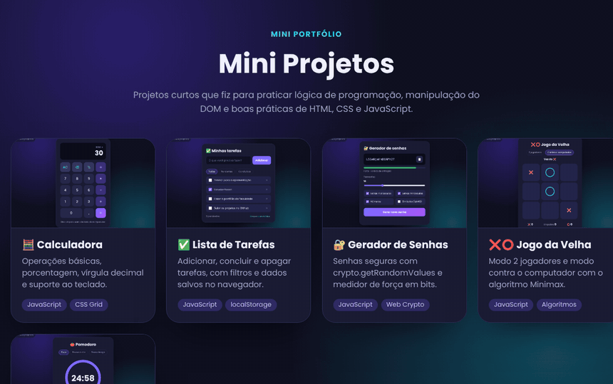

# 🧩 Mini Projetos

Coleção de projetos curtos em **HTML, CSS e JavaScript puro** que fiz para praticar lógica de programação, manipulação do DOM e boas práticas de front-end. Cada pasta é um app independente, e a página inicial reúne todos em uma galeria.



🔗 **Ver online:** https://beatrizaandradee.github.io/mini-projetos ← _ative o GitHub Pages_

---

## 📦 Projetos

| Projeto | O que pratiquei | Abrir |
|---|---|---|
| 🧮 **Calculadora** | Estado da aplicação (número anterior, operação, número atual), eventos de clique e de teclado, tratamento de divisão por zero e de erros de ponto flutuante | [`/calculadora`](calculadora/) |
| ✅ **Lista de Tarefas** | CRUD, filtros, `localStorage`, `textContent` para evitar injeção de HTML, validação de formulário | [`/lista-de-tarefas`](lista-de-tarefas/) |
| 🔐 **Gerador de Senhas** | `crypto.getRandomValues` (aleatoriedade segura), embaralhamento Fisher-Yates, cálculo de entropia em bits, Clipboard API | [`/gerador-de-senhas`](gerador-de-senhas/) |
| ❌⭕ **Jogo da Velha** | Lógica de vitória, placar, modo contra o computador com **Minimax** (algoritmo recursivo: a CPU nunca perde) | [`/jogo-da-velha`](jogo-da-velha/) |
| 🍅 **Pomodoro** | `setInterval`, anel de progresso em SVG (`stroke-dashoffset`), Web Audio API para o alarme, contador de ciclos do dia | [`/pomodoro`](pomodoro/) |

## 🛠️ Tecnologias

- **HTML5** semântico com atributos de acessibilidade (`aria-label`, `aria-live`)
- **CSS3**: Grid, Flexbox, variáveis CSS, animações, layout responsivo
- **JavaScript (ES6+)**: sem bibliotecas nem frameworks

## 📂 Estrutura

```
mini-projetos/
├── index.html            # Galeria com todos os projetos
├── shared.css            # Estilo base compartilhado
├── calculadora/          # index.html · style.css · script.js
├── lista-de-tarefas/
├── gerador-de-senhas/
├── jogo-da-velha/
├── pomodoro/
└── docs/                 # Prints e GIF
```

## 🚀 Como rodar

Não precisa instalar nada:

```bash
git clone https://github.com/beatrizaandradee/mini-projetos.git
cd mini-projetos
```

Abra o `index.html` no navegador (ou use a extensão **Live Server** do VS Code).

### Publicar no GitHub Pages
**Settings → Pages → Branch: `main` / root → Save.** Cada projeto fica com um link próprio, por exemplo `https://beatrizaandradee.github.io/mini-projetos/calculadora/`.

### Adicionar um novo mini projeto
1. Crie uma pasta com `index.html`, `style.css` e `script.js`
2. Coloque um print em `docs/nome-da-pasta.png`
3. Acrescente um item na lista `projetos` do `index.html` da raiz

---

Desenvolvido por **Beatriz Almeida Andrade**, estudante de Engenharia de Software na PUC Minas · [LinkedIn](https://www.linkedin.com/in/beatriz-almeida-975408325/) · [GitHub](https://github.com/beatrizaandradee)
